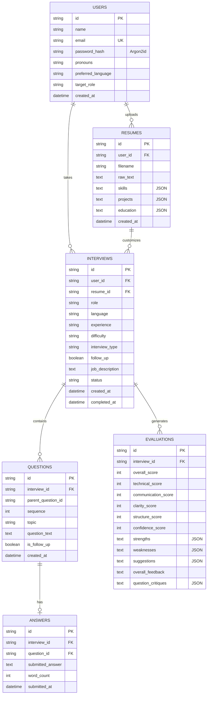

# Interview AI — AI-Powered Interview Preparation Platform

> **Tagline**: *"Prepare smarter. Interview better. Grow confidently."*  
> A commercial-grade, full-stack AI platform designed to help students, freshers, and experienced professionals prepare for technical job interviews through personalized mock interviews, PyMuPDF resume intelligence, dual voice interactions, and deep rubric evaluations.

---

## 🎨 Design Philosophy & Architecture (Matching Startup Aesthetics)

The application follows a warm editorial and human-friendly design inspired by leading commercial platforms (such as *Ascend*, *ElevateAI*, and *Prentus*):
- **Warm Editorial Canvas (Light Mode)**: Linen cream (`#fbf9f4`), rich forest green (`#193b2d`) badges, and terracotta/clay (`#c06a45`) primary action buttons.
- **Dark Obsidian Canvas (Dark Mode)**: Deep charcoal zinc (`#0f1115` & `#181b22`) with emerald sage accents (`#34d399`), offering high contrast without aggressive neon blue or glassmorphism soup.
- **Theme Switcher**: Complete light/dark theme switcher with persistent storage in `localStorage`.
- **Circular Rubric Gauge**: Prentus-style SVG circular ring meter (`82 out of 100`) with horizontal dimensional breakdown bars (`Clarity`, `Structure`, `Confidence`, `Technical Depth`).
- **Career Preparation Route**: Ascend-style journey route graph (`Resume Intake` → `Core Viva` → `System Architecture` → `Placement Summit`).

---

## 📋 Comprehensive Tech Stack

| Domain | Technology | Implementation Details |
| :--- | :--- | :--- |
| **Frontend Framework** | **React.js (v19) + Vite** | High-speed SPA with instant HMR and optimized production bundling |
| **Styling & Design** | **Tailwind CSS (v4)** | Light warm parchment & dark obsidian design system |
| **Data Visualizations** | **Recharts** | Interactive `LineChart` and `ResponsiveContainer` tracking score trajectories |
| **Iconography** | **Lucide React** | Lightweight, clean SVG icons (`Compass`, `Bot`, `Mic`, `Award`, `FileText`) |
| **Client Routing** | **React Router DOM (v7)** | Client-side routing with protected view redirects |
| **API Client** | **Axios** | REST client with automatic Bearer token interceptor |
| **Backend Framework** | **FastAPI (Python 3.12/3.13)** | Modular RESTful API routers (`auth`, `users`, `resumes`, `interviews`, `dashboard`, `history`) |
| **Database & ORM** | **SQLite + SQLAlchemy** | 6 normalized relational database tables with foreign keys and cascade rules |
| **Authentication** | **Argon2id + JWT** | Memory-hard **Argon2id** password hashing (`argon2-cffi`) + HS256 JWT tokens |
| **Artificial Intelligence** | **Google Gemini API** | Contextual viva question generation & rubric evaluations (`gemini-2.5-flash`) |
| **Zero-Crash Engine** | **Smart Local Evaluator** | Non-blocking offline fallback generator (<200ms) ensuring zero presentation crashes |
| **Voice Interaction** | **Web Speech API** | Dual speech engine: Speech-to-Text mic dictation + Text-to-Speech question reader |
| **Resume Extraction** | **PyMuPDF + OCR** | Deep PDF text extraction with automatic project detection & Tesseract OCR fallback |

---

## 🗄️ Relational Database Architecture (6 Tables)

Persistent SQLite database at `backend/interview_coach.db`:



---

## 🚀 How to Run in VS Code

### Terminal 1: FastAPI Backend
```powershell
cd backend
.\venv\Scripts\activate
python -m uvicorn main:app --reload --port 8000
```
> Interactive API Documentation: [http://127.0.0.1:8000/docs](http://127.0.0.1:8000/docs)

### Terminal 2: React Frontend
```powershell
cd frontend
npm run dev
```
> Open [http://localhost:5173](http://localhost:5173) in Google Chrome or Microsoft Edge.

---

## 🏆 Presentation Walkthrough for Evaluators & Teachers

1. **Landing Page (`/`)**:
   - Point out the clean editorial branding, the Ascend-inspired step pills (`01 ASSESS` → `05 EVOLVE`), and the preparation route card.
2. **1-Click Demo Login (`Navbar → 1-Click Demo`)**:
   - Click the amber demo button to sign in as *Aarav Sharma* without typing credentials.
3. **ElevateAI Dashboard (`/dashboard`)**:
   - Show the dynamic greeting, Readiness Index badge (`82 / 100`), recent simulation cards (`09/10`), Recharts trajectory, and domain breakdown table.
4. **Interview Setup (`/setup`)**:
   - Customize target role, tech skills tags, difficulty, and upload a PDF resume for live PyMuPDF analysis.
5. **Live AI Interview Room (`/interview/:id`)**:
   - Demonstrate **"Listen Aloud"** (TTS) and **"Dictate via Mic"** (live STT voice transcription).
6. **Prentus Evaluation Report (`/evaluation`)**:
   - Showcase the SVG circular score ring, dimension breakdown bars (`Clarity`, `Structure`, `Confidence`, `Technical Depth`), strengths/weaknesses, and benchmark model answers. Click **"Print / Save PDF"** to demonstrate portfolio export.
7. **History & Resumes (`/history` & `/resumes`)**:
   - Show saved interview sessions, filters, and parsed resume archives.
8. **Profile & Settings (`/profile` & `/settings`)**:
   - Update candidate pronouns/role, test password change, and toggle light/dark modes.
